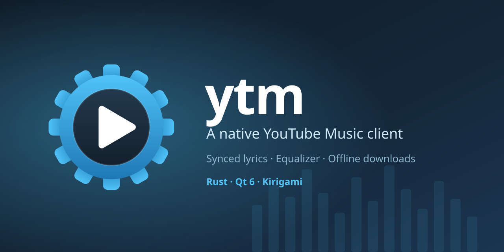
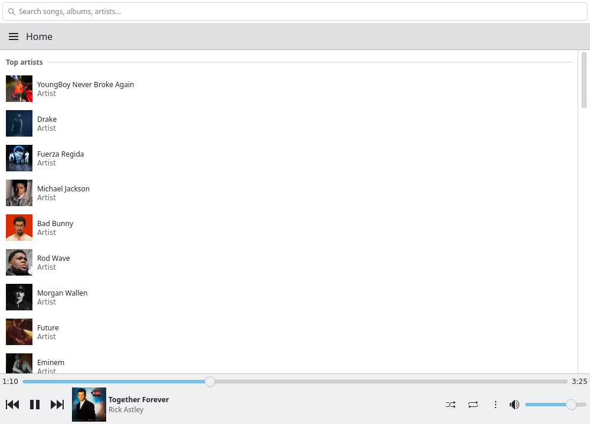
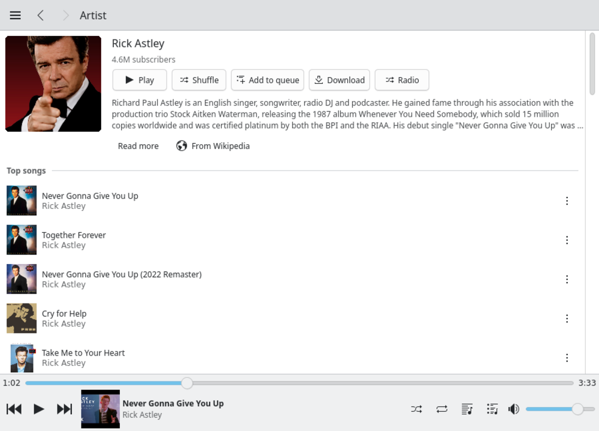
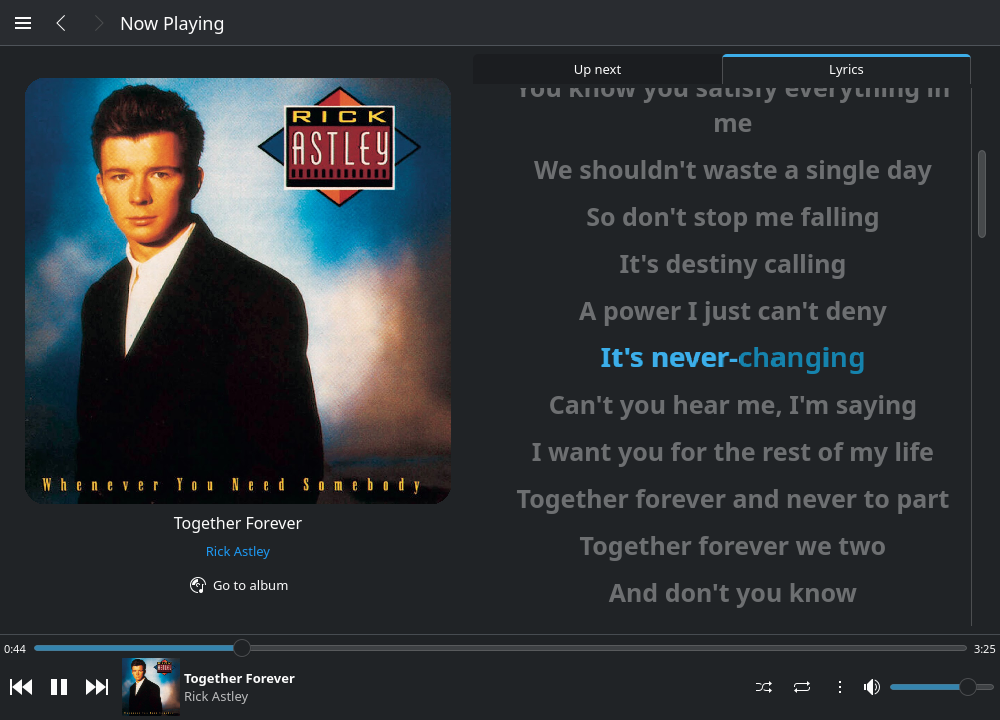
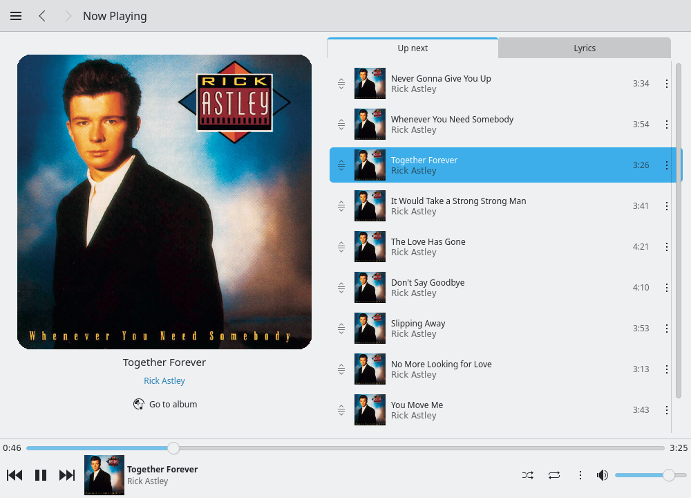
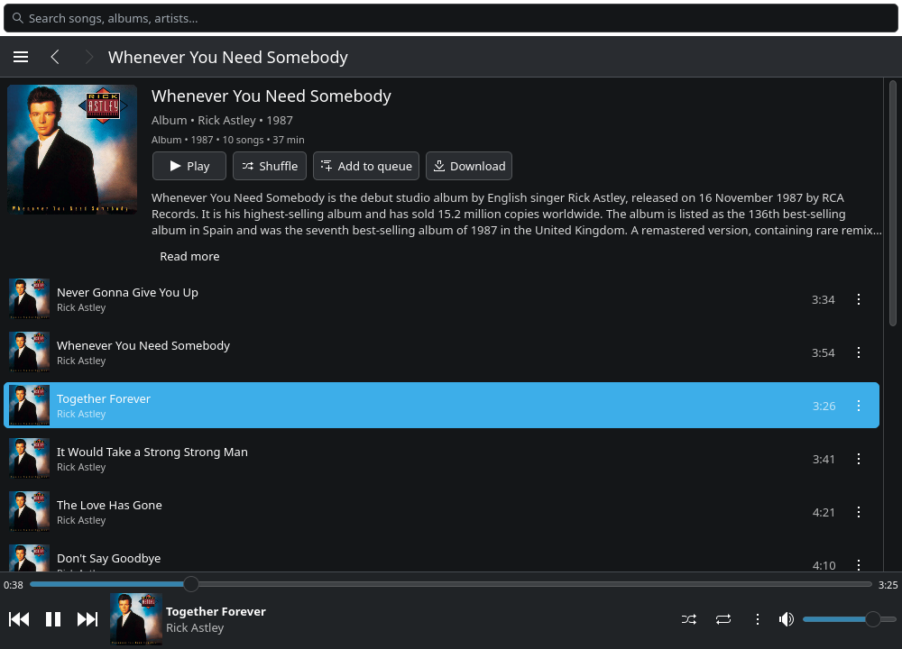
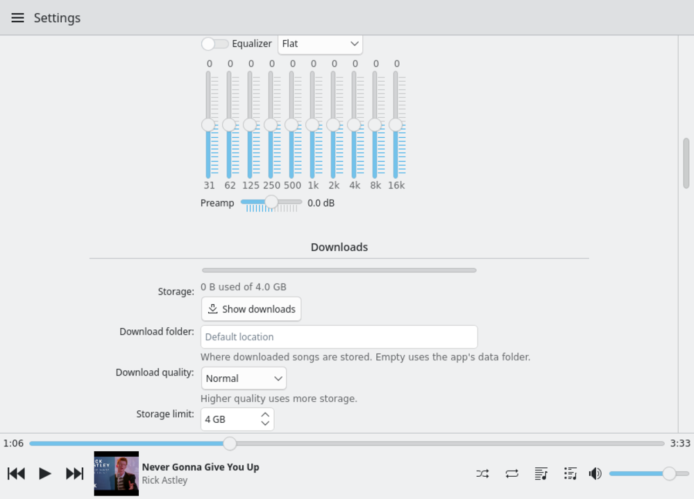

<p align="center"></p>

# YQT

A native YouTube Music client written in **Rust**, **Qt 6** ([cxx-qt](https://github.com/KDAB/cxx-qt)) and **Kirigami**.
No browser engine, no Electron, no FFmpeg, no system OpenSSL: networking is rustls and the optional audio engine is pure Rust.

It looks and behaves like a normal KDE application: standard Kirigami and Breeze controls, nothing hand-drawn.

<p align="center">
  
  
</p>
<p align="center">
  
  
</p>
<p align="center">
  
  
</p>

## Features

- **Browse and play:** Home and Explore as shelves of cards; album, playlist and artist pages with a description or bio (YouTube's own text) and a Wikipedia link; Library, search, queue, shuffle, repeat, radio.
- **Lyrics:** [LRCLIB](https://lrclib.net), NetEase and YouTube's plain lyrics are asked in parallel and line-synced lyrics always win. Big type, the current line tinted with the cover's colour and filled as it is sung, the source as a quiet last line. Each provider can be switched off; they only ever receive title, artist and duration.
- **Player:** transport on the left of the bar, smooth progress, press the bar to open or close the player; the queue reorders by dragging and has a ⋮ and right-click menu on every row.
- **Downloads:** per song, album or playlist, plus opt-in smart downloads (liked songs, recently played, upcoming queue) within a storage limit (4 GB by default, configurable). Quality, your own folder, and automatic pause on a metered connection or low battery. Downloaded songs play from disk and work offline.
- **Audio:** Qt Multimedia by default; switch to the built-in **pure-Rust engine** (symphonia, Opus via [opus-rs](https://crates.io/crates/opus-rs), AAC, resampling, limiter) for gapless playback, crossfade, loudness normalisation and a **10-band equalizer** with presets and preamp.
- **Mini-player and system tray** (Linux: a StatusNotifierItem over D-Bus), close to the tray, MPRIS media keys, configurable keyboard shortcuts.
- **Sign-in:** Settings → *Import from <browser>* (Chrome, Chromium, Brave, Vivaldi, Edge, Opera, Firefox, Zen, LibreWolf, Waterfox) or paste cookies. Enables Library, Liked music, History, personalised Home, likes and add-to-playlist, and **reports plays back to YouTube** so your history and recommendations stay right (Settings → Privacy turns it off).
- **Settings:** one scrolling page; every change is validated, saved to `config.toml` with your comments intact, and applies at once.

## Build and run

You need [just](https://just.systems), Rust, Qt 6 (base, declarative, multimedia) and Kirigami with qqc2-desktop-style, which together give the KDE look.

### Linux

Install Qt 6, Kirigami and qqc2-desktop-style from your distro (on Debian/Ubuntu: `qt6-base-dev qt6-declarative-dev qt6-multimedia-dev libkf6kirigami-dev qml6-module-org-kde-kirigami qml6-module-org-kde-qqc2-desktop-style`; ALSA is needed for the Rust audio engine), then:

```sh
just run          # debug build and run
just check        # fmt + clippy + tests
just install      # ~/.local/bin + desktop entry
just              # list every recipe
```

### Windows (experimental)

Qt and Kirigami come from [KDE Craft](https://community.kde.org/Craft), so the app looks like it does on Plasma: same Kirigami and Breeze controls, same icons. In PowerShell:

```powershell
winget install Casey.Just
just win-setup        # Rust, MSVC Build Tools, Craft + Qt 6 + Kirigami (one-time; long)
just win-doctor       # checks the toolchain and the QML modules
just win-build        # release build against Craft's Qt
just package-windows  # dist\YQT-windows\ and a .zip, with Qt, Kirigami and Breeze icons bundled
```

From Linux you can cross-compile the exe instead (needs `cargo-xwin`, `clang-cl`, `lld` and `pipx`): `just win-cross-qt` once (downloads Windows Qt 6.10 and matching host tools into `.cross/`), then `just win-cross` gives `target/x86_64-pc-windows-msvc/release/yqt.exe`. That is a compile-and-link check only; running it still needs Qt and Kirigami DLLs next to it.

Craft is expected in `C:\CraftRoot`; set `YTM_QT_ROOT` if yours is elsewhere. The scripts are in `packaging/windows/`.

### macOS (experimental)

Install Qt 6 and Kirigami through Craft, then `just package-macos` builds a `.app` with `macdeployqt`.

### Other recipes

`just deny` (licences, advisories; OpenSSL is banned), `just live` (live checks against YouTube and LRCLIB, needs network), `just config` (where `config.toml` lives).

## How it works

- **Data:** [RustyPipe](https://github.com/TeamPiped/rustypipe) (InnerTube client) for search, browse, library and history.
- **Streams:** InnerTube's visionOS client (`src/vision.rs`), served through a small token-protected localhost proxy (`src/proxy.rs`). Settings → *Check streams* tests the route.
- **Logic lives in Rust**: list models, page controllers, paging and caching, errors, downloads, lyrics ranking, settings. QML is the view.

## Configuration

Everything tunable lives in `config.toml` (`just config` prints its path; it is created with the defaults on first run), and most of it is also in the Settings page.
Invalid values are ignored with a warning; the app never refuses to start because of this file.

## Privacy and security

See [SECURITY.md](SECURITY.md) for the threat model. In short: your cookies stay on your machine (private file permissions) and are only sent to YouTube; lyrics providers see what you play; downloads are stored unencrypted in the app's folder, so keep them for personal offline listening.

## Platforms

| | Linux | macOS | Windows |
|---|---|---|---|
| Builds and runs | ✅ developed and tested | ⚠️ not built yet | ⚠️ not built yet |
| Look | Kirigami + Breeze, follows Plasma | same (`org.kde.desktop`, Fusion only if missing) | same (`org.kde.desktop`, Fusion only if missing) |
| Sign-in: paste cookies | ✅ | ✅ | ✅ |
| Sign-in: Firefox-family import | ✅ | ✅ (logic tested) | ✅ (logic tested) |
| Sign-in: Chromium-family import | ✅ KWallet / libsecret | ✅ Keychain (logic tested) | ⚠️ DPAPI + AES-GCM; not Chrome/Edge/Brave 127+ (app-bound encryption), so paste cookies or use Firefox; close the browser first |
| System tray, media keys | ✅ tray (StatusNotifierItem) and MPRIS | ❌ not implemented | ❌ not implemented |
| Packaging | `just install` | `just package-macos` | `just package-windows` |

"Logic tested" means path discovery, key derivation and decryption are unit-tested with synthetic data, and the sign-in code is type-checked for `x86_64-pc-windows-{msvc,gnu}` and `aarch64-apple-darwin` (`just check-platforms`).
The real Keychain and DPAPI calls and the Qt/Kirigami build on macOS and Windows have **not** been run.

## Known gaps

- The Rust audio engine is tested against reference decoders, but nobody has listened to it for long yet, which is why Qt Multimedia is still the default.
- The app follows your desktop's colour scheme; there is no separate light/dark setting (the KDE style ignores an app-level request).
- Not yet confirmed on a live Plasma session: the tray icon in a real panel (it is tested against a fake tray host: `just tray-test`), the mini-player's always-on-top flag on Wayland, and the bar's colour in a genuinely unfocused window (the colour pin is checked against a forced Inactive palette).
- Queue drag-to-reorder is tested with synthesised mouse events (`just qml-test`), not with a physical mouse.
- NetEase lyrics use an unofficial API and may stop working.

## License

GPL-3.0-only (see [LICENSE](LICENSE)). RustyPipe, which this app builds on, is also GPL-3.0.
