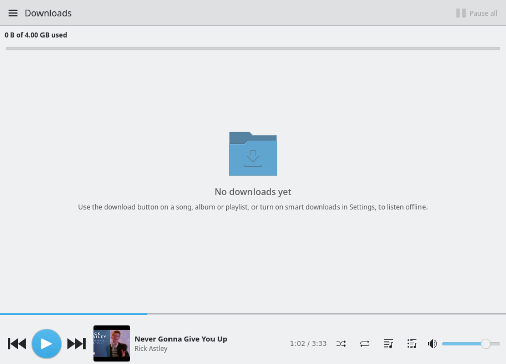

<p align="center"></p>

# ytm

A native YouTube Music client written in **Rust**, **Qt 6** ([cxx-qt](https://github.com/KDAB/cxx-qt)) and **Kirigami**.
No browser engine, no Electron, no FFmpeg, no system OpenSSL: networking is rustls and the optional audio engine is pure Rust.

<p align="center">
  
  
</p>
<p align="center">
  
  
</p>

## Features

- **Rich pages:** Home shelves, album / playlist / artist pages with a tinted hero, track lists, cards and round artist avatars. The artist bio is YouTube's own text, with a link to Wikipedia.
- **Lyrics:** [LRCLIB](https://lrclib.net), NetEase and YouTube's plain lyrics are asked in parallel and **line-synced lyrics always win**. Big type, a karaoke fill between timestamps, gap dots in instrumentals, tap a line to seek. The source credit is the very last line. Each provider can be switched off; they only ever receive title, artist and duration.
- **Downloads:** per song, album or playlist, plus opt-in *smart downloads* (liked songs, recently played, next in queue) within a storage limit (4 GB by default, configurable). Quality Best / Normal / Data saver, your own folder, and automatic pause on a metered connection or low battery. Downloaded songs play from disk and work offline.
- **Audio:** the default player is Qt Multimedia; a **pure-Rust engine** (symphonia demux, Opus via [opus-rs](https://crates.io/crates/opus-rs), AAC, resampling, 10-band equalizer with presets and preamp, limiter, gapless, crossfade, loudness normalization) can be switched on in Settings.
- **Queue:** drag to reorder, a ⋮ menu and right-click on every row.
- **Player bar:** transport on the left, smooth sub-second progress, press it to open or close the full player.
- **Mini-player and system tray**, MPRIS media keys on Linux, configurable keyboard shortcuts.
- **Sign-in:** Settings → *Import from <browser>* (Chrome, Chromium, Brave, Vivaldi, Edge, Opera, Firefox, Zen, LibreWolf, Waterfox) or paste cookies. Enables Library, Liked music, History, personalised Home, likes and add-to-playlist, and **reports plays back to YouTube** so your history and recommendations stay right (Settings → Privacy turns it off).
- **Settings:** one scrolling page with search; every change applies live and is saved to `config.toml` with your comments intact.

<p align="center">
  
  
  
</p>

## Build and run

```sh
just run        # or: cargo run
just check      # fmt + clippy + tests
just deny       # licences, advisories, bans (OpenSSL is banned)
just live       # live checks against YouTube / LRCLIB (network)
just            # list all recipes
```

Needs Rust, Qt 6 (base, declarative, and multimedia for the default player), Kirigami and, on Linux, qqc2-desktop-style and ALSA (for the Rust audio engine).
Kirigami on Windows and macOS comes from [KDE Craft](https://community.kde.org/Craft).

## How it works

- **Data:** [RustyPipe](https://github.com/TeamPiped/rustypipe) (InnerTube client) for search, browse, library and history.
- **Streams:** InnerTube's visionOS client (`src/vision.rs`), served through a small token-protected localhost proxy (`src/proxy.rs`). Settings → *Check streams* tests the route.
- **Logic lives in Rust**: list models, page controllers, paging and caching, errors, downloads, lyrics ranking, settings. QML is the view.

## Configuration

Everything tunable lives in `config.toml` (`just config` prints its path; it is created with the defaults on first run), and most of it is also in the Settings page.
Invalid values are ignored with a warning; the app never refuses to start because of this file.

## Privacy and security

See [SECURITY.md](SECURITY.md) for the threat model. In short: your cookies stay on your machine (private file permissions) and are only sent to YouTube; lyrics providers see what you play; downloads are stored unencrypted in the app's folder, so keep them for personal offline listening.

## Platforms

| | Linux | macOS | Windows |
|---|---|---|---|
| Builds & runs | ✅ developed and tested here | ⚠️ not built | ⚠️ not built |
| Sign-in: paste cookies | ✅ | ✅ | ✅ |
| Sign-in: Firefox-family import | ✅ | ✅ (logic tested) | ✅ (logic tested) |
| Sign-in: Chromium-family import | ✅ KWallet / libsecret | ✅ Keychain (logic tested) | ⚠️ DPAPI + AES-GCM; **not** Chrome/Edge/Brave 127+ (app-bound encryption; paste cookies or use Firefox); close the browser first |
| Media keys (MPRIS) | ✅ | ❌ not implemented | ❌ not implemented |
| Packaging | `just install` | `just package-macos` (experimental) | `just package-windows` (experimental) |

"Logic tested" means path discovery, key derivation and decryption are unit-tested with synthetic data on Linux, and the sign-in code is type-checked for
`x86_64-pc-windows-{msvc,gnu}` and `aarch64-apple-darwin`. The real macOS Keychain and Windows DPAPI calls, the Qt/Kirigami build on those systems and their CI jobs have **not** been run.

## Known gaps

- The Rust audio engine is tested against reference decoders, but nobody has listened to it for long yet, which is why Qt Multimedia is still the default.
- The *Theme* setting (light / dark) is honoured only by styles that follow Qt's colour-scheme request; the KDE desktop style follows your Plasma colour scheme instead.
- NetEase lyrics use an unofficial API and may stop working.

## License

GPL-3.0-only (see [LICENSE](LICENSE)). RustyPipe, which this app builds on, is also GPL-3.0.
